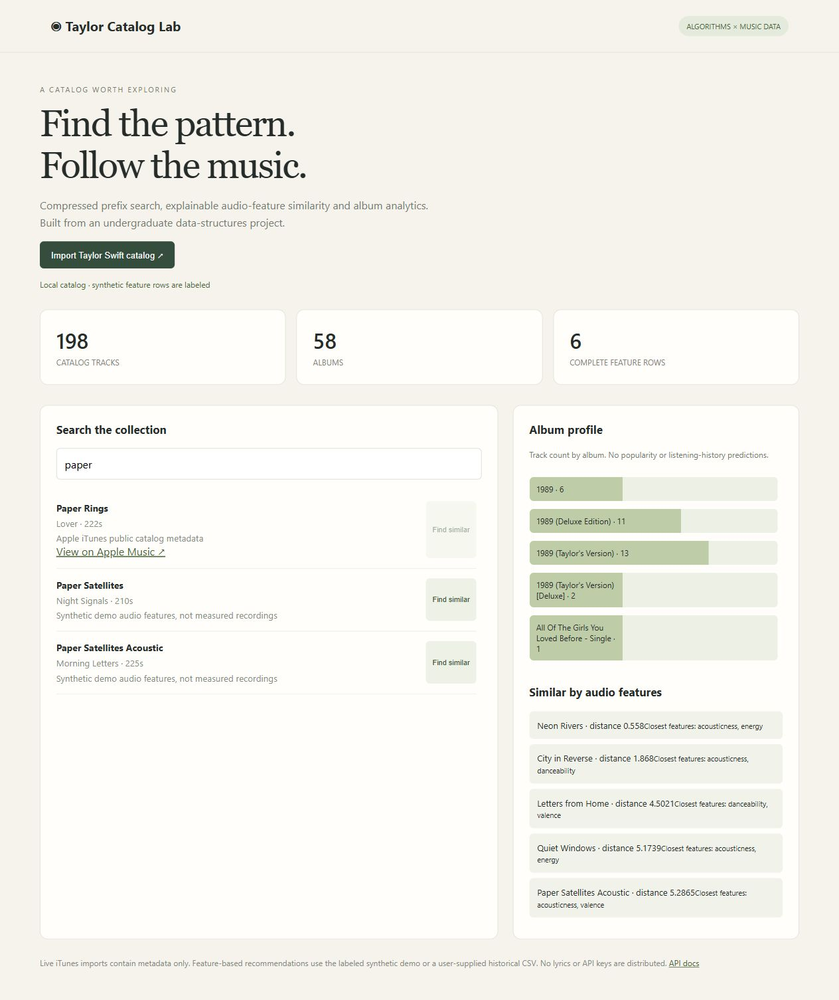

# Taylor Catalog Lab

**Music catalog engineering with searchable data, audio-feature analytics and a web interface.** A modernization of my undergraduate Python project, retaining its focus on PATRICIA-style prefix search and hash-based word frequencies.



## Run

```sh
python -m venv .venv
# Windows: .venv\Scripts\activate
# macOS/Linux: source .venv/bin/activate
pip install -e ".[dev]"
uvicorn taylor_lab.api:app --reload
# Open http://127.0.0.1:8000; API docs at /docs
pytest -q
# Optional: pip install -r requirements-tested.txt
```

Docker: `docker build -t taylor-catalog-lab .` then `docker run --rm -p 127.0.0.1:8000:8000 taylor-catalog-lab`.

## Explore

The default offline dataset contains **six fictional tracks and synthetic feature values**. It demonstrates prefix search, album statistics and similarity without credentials or redistribution of third-party datasets.

“Import Taylor Swift catalog” fetches a bounded public metadata sample from Apple's iTunes API. These records include store links, albums, release dates and durations. They contain **no audio features**. Recommendations remain disabled for those records rather than inventing features. The integration does not download audio, artwork or lyrics.

To use the original historical CSV locally:

```sh
python import_csv.py "path/to/taylor_swift_spotify.csv"
```

The original dataset is excluded from GitHub because its redistribution license was not provided. Its metrics are historical, not live Spotify information. The CSV importer keeps audio-feature availability explicit and validates finite values and ranges. Only import data you have permission to use.

## From coursework to service

| Original approach | Modernized implementation |
|---|---|
| Terminal menu and global filenames | FastAPI endpoints and responsive browser interface |
| Pickled tables and search trees | SQLite persistence with transactional, idempotent imports |
| PATRICIA title lookup | Compressed radix index with safe empty/no-match handling and duplicate titles |
| Fixed-size hash table | Resizable open-addressed frequency table with collision tests |
| Album plotting | Album aggregates and feature-based similarity explanations |
| Embedded runtime and API-key setting | Installable package, environment-independent paths, no bundled secrets |

`legacy/` preserves the original Python files for comparison. They are reference material, not imported by the modern service. A hardcoded credential setting has been replaced with an environment-variable lookup. No executable, DLL, pickle, lyrics corpus or private dataset is published.

## Algorithms

- **Prefix search:** compressed radix tree over normalized titles. Edge splitting handles shared prefixes, Unicode accents, duplicate titles and titles that are prefixes of other titles. The in-memory index is rebuilt from SQLite per search for simplicity; cache it with invalidation if the catalog grows.
- **Frequency counting:** FNV-1a hashing, linear probing and resizing at 70% occupancy. The displayed counts cover **track-title words**, not lyrics.
- **Similarity:** Euclidean distance over five standardized audio features (acousticness, danceability, energy, valence, tempo). Catalog means and standard deviations prevent tempo from dominating. Results show the two smallest feature-distance contributions. This is a content-based baseline, not a trained preference model or subjective music judgment.
- **Data integrity:** stable external IDs, parameterized queries, batch validation before writes, transactional upserts, per-record provenance and import timestamps.

## API

| Route | Purpose |
|---|---|
| `GET /api/tracks?prefix=paper` | Prefix search; optional exact album filter |
| `GET /api/analytics` | Album counts, mean features, title-word frequencies |
| `GET /api/recommend/{id}` | Standardized feature similarity |
| `POST /api/import/itunes` | Import the fixed artist's public metadata sample |

Tests compare radix results against a linear scan over randomized titles, force hash collisions through resizing, verify transactional validation and exercise the full API. GitHub Actions also builds the container.

This is a local portfolio prototype: no authentication, quotas or public hosting are included. Live catalog availability and rate limits depend on Apple; the offline demo remains available on fetch failure. A six-track demo is not a recommendation-quality benchmark.

[Apple Search API documentation](https://performance-partners.apple.com/search-api). Original project and modernization by Arthur Coltro de Andrade; no affiliation with Taylor Swift, Apple or Spotify.
